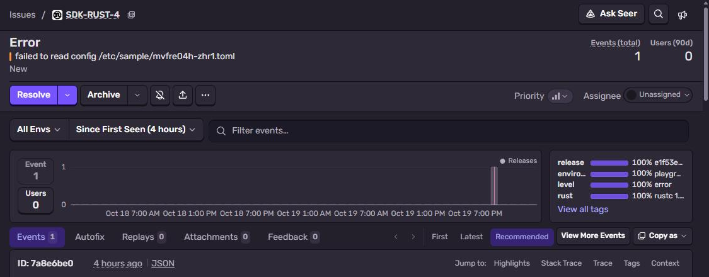
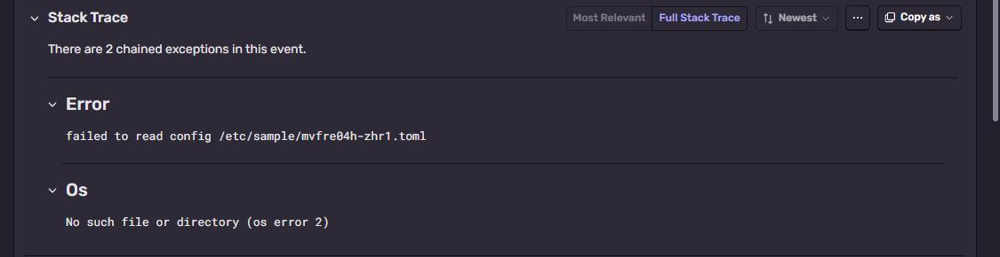
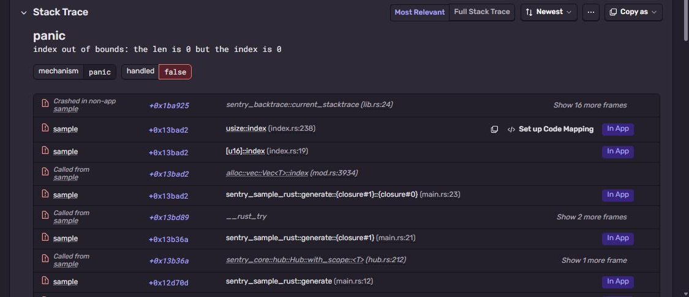

# Sentry + Rust

Rust binary with the `sentry` crate: an `anyhow` error with context, and a panic.
Part of [Sentry Playground](https://github.com/fsmaster/sentry-playground).



## What you need

- Rust 1.85+ (edition 2024), `rustup` is the easy way
- Sentry project with platform **Rust**

## 1. Get the DSN

Sentry → **Settings → Projects → (project) → Client Keys (DSN)**.

## 2. Run it

```bash
git clone https://github.com/fsmaster/sentry-sample-rust.git
cd sentry-sample-rust
export SENTRY_DSN="https://<key>@<org>.ingest.us.sentry.io/<project-id>"
cargo run -- error
cargo run -- panic
```

First build takes a minute. Docker variant:

```bash
docker build -t sentry-sample-rust .
docker run --rm -p 8080:8080 -e SENTRY_DSN="..." sentry-sample-rust
curl -X POST localhost:8080/trigger -d '{"run":"test-1","kind":"panic"}'
```

## 3. Check it in Sentry

**The anyhow error** `Error: failed to read config /etc/sample/....toml`. Sentry shows the whole
`.context()` chain as chained exceptions, the original `No such file or directory (os error 2)` is the
second one:



There are no frames on it unless the process runs with `RUST_LIB_BACKTRACE=1` (or `RUST_BACKTRACE=1`),
anyhow only records a backtrace then. The Dockerfile sets it.

**The panic** `panic: index out of bounds: the len is 0 but the index is 0`. Frames are symbolicated by the
SDK itself, inside the process, so you see `sentry_sample_rust::generate` and `main.rs:23` without
uploading anything:



The red "Processing Error" there means Sentry also tried to find a debug file for the binary and there
is none. Harmless here. If you strip the binary, upload it with
`sentry-cli debug-files upload --include-sources target/release/` like in the
[native sample](https://github.com/fsmaster/sentry-sample-native).

## How it works

```rust
let mut options = sentry::ClientOptions::default();
options.release = Some("sample-rust@dev".into());
let _guard = sentry::init((env::var("SENTRY_DSN").ok(), options));
```

- Keep `_guard` alive until the end of `main`. When it's dropped, it flushes the queue. If you write
  `let _ = sentry::init(...)` the guard is dropped right away and nothing is sent.
- Default features include the `panic` integration, so panics are reported without extra code.
- `anyhow` feature gives `sentry::integrations::anyhow::capture_anyhow(&err)`, which keeps the whole
  `.context()` chain.
- Since sentry 0.49 `ClientOptions` is `#[non_exhaustive]`, so `ClientOptions { release: ..., ..Default::default() }`
  doesn't compile anymore. Set fields one by one like above.

`Cargo.toml` has `debug = true` in release profile. Then the binary has file names and line numbers and
Sentry can show them. Without it you get function names only.

## Troubleshooting

| Symptom | Why |
|---|---|
| `cannot create non-exhaustive struct using struct expression` | Old example code, see the last point above. |
| Nothing arrives | `_guard` dropped too early, or no DSN. |
| Frames without line numbers | Release build without debug info. |
